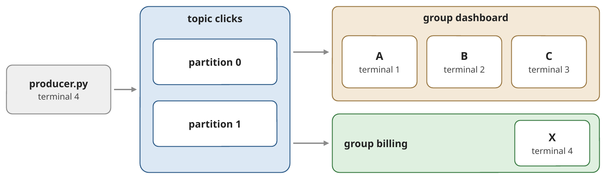
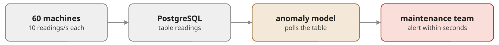

# Exercise 5 Messaging Platforms: Fundamentals

**Goal:** get hands-on with Apache Kafka's building blocks (topics,
partitions, keys, offsets and consumer groups), then use them on an AI
problem: a predictive-maintenance pipeline with a stateful ML model. You
find out where a database alone stops being enough, decide on an
architecture, and, as an optional challenge, build it.

**Builds on the lecture "Messaging Platforms – Fundamentals".**

| Part | What |
|------|------|
| 0 | Setup: download images, prepare Python |
| 1 | Kafka quick start: topics, keys, consumer groups, offsets (guided, not graded) |
| 2 | *Line Guardian*, an AI challenge (graded) |

## Part 0 — Setup

The three images (PostgreSQL, Kafka, Kafka UI) are **~1.2 GB** together.
Please download them beforehand:

```bash
docker compose pull
docker compose up -d
```

Then check that:

1. `docker ps` shows three running containers: `postgres`, `kafka` and
   `kafka-ui`.
2. <http://localhost:8080> opens the Kafka UI.

Prepare a Python virtual environment in this folder (on Windows use `python`
or `py` instead of `python3`, and `venv\Scripts\activate` instead of
`source venv/bin/activate`):

```bash
python3 -m venv venv
source venv/bin/activate
pip install --upgrade pip
pip install -r requirements.txt
```

All Python commands below assume this environment is active.

> **Containers from earlier exercises** use the same ports (e.g. 5432).
> Stop them first: `docker compose down` in their folder.

## Part 1 — Kafka quick start (guided, not graded)

Four steps, one idea each; Part 2 builds on all four. In every step,
**predict** first, then run the commands, then check.

Open a terminal in `clients/` with the virtual environment active. The
broker runs at `localhost:9092`. The Kafka command-line tools run inside the
`kafka` container (`docker exec -it kafka …`); the Kafka UI
(<http://localhost:8080>) shows the same information in the browser.

### 1. A topic is a set of logs

```bash
docker exec -it kafka kafka-topics.sh --bootstrap-server localhost:9092 \
  --create --topic clicks --partitions 2 --replication-factor 1

docker exec -it kafka kafka-topics.sh --bootstrap-server localhost:9092 \
  --describe --topic clicks
```

The topic `clicks` has two **partitions**: two append-only logs in which
every new event gets the next **offset** (0, 1, 2, …). Partitions are the
unit of parallelism. (`--replication-factor 1`: one copy of each
partition, because we have a single broker.) Kafka keeps events for 7 days
by default (`retention.ms`), whether anybody read them or not.

### 2. Keys decide the partition

`producer.py` sends 20 click events with the keys `user-1` … `user-4` and
prints the partition and offset of each event.

*Predict:* run it twice. Does `user-1` land in the same partition both
times? Where do events without a key go?

```bash
python3 producer.py
python3 producer.py
python3 producer.py --no-key
```

> **Same key → same partition → same order.** The partition is
> `hash(key) mod number of partitions`, on every run. Events without a key
> are spread over both partitions: the order per user is lost.

### 3. Consumer groups share the work

`consumer.py` joins a consumer group and prints the partitions it gets and
every event it reads. Keep your terminal for the producer and open three
more in `clients/` (virtual environment active). Start `A`, `B` and `C`
one after the other; wait each time until the new consumer prints its
partitions.

*Predict:* three consumers, two partitions. Who gets what?

```bash
python3 consumer.py --group dashboard --name A
python3 consumer.py --group dashboard --name B
python3 consumer.py --group dashboard --name C
```



Send events (`python3 producer.py`): who reads which keys? Then start a
consumer of a **second** group in the producer's terminal:
`python3 consumer.py --group billing --name X`. Which events does `X` read?

> **Within a group, one partition → one consumer.** `C` stays idle: more
> consumers than partitions do not help. Every join or leave triggers a
> **rebalance**, and a partition can move to another consumer. Another
> group (`X`) reads all events on its own, without changing `dashboard`.

### 4. Offsets: where a group continues

Stop all consumers (`Ctrl+C`). *Predict:* you send 20 more events. Where
does `dashboard` continue when `A` comes back?

```bash
python3 producer.py

docker exec -it kafka kafka-consumer-groups.sh --bootstrap-server localhost:9092 \
  --describe --group dashboard
```

Per partition: `CURRENT-OFFSET` (where the group is), `LOG-END-OFFSET` (the
end of the log) and `LAG` (the difference). Start `A` again and check your
prediction. Then replay the whole topic for `billing`, and start `X` again:

```bash
docker exec -it kafka kafka-consumer-groups.sh --bootstrap-server localhost:9092 \
  --group billing --topic clicks --reset-offsets --to-earliest --execute
```

> **The committed offset is the group's position in the log, stored in
> Kafka.** A consumer continues where its group stopped; the lag says how
> far behind it is. Reading deletes nothing: a reset (or a new group) reads
> the history again, e.g. to fill a new service or to reprocess after a bug
> fix, without affecting other groups.

### What you take into Part 2

| You saw | In Part 2 it decides |
|---|---|
| key → partition | whether all readings of a machine reach the same detector, in order |
| one consumer per partition | how many detector instances can work in parallel |
| independent groups | whether an archive or a dashboard can read without disturbing the detector |
| offsets and lag | whether the detector keeps up, and where it starts reading |

## Part 2 — *Line Guardian*: predictive maintenance (graded)

**Scenario.** A manufacturer runs CNC machine tools (Computer Numerical
Control: computer-controlled milling machines and lathes) and
injection-moulding machines.
When a spindle bearing fails, the line stands still for a shift. The data
science team has trained a model that recognises bearing wear in the
vibration signal tens of seconds before it becomes critical. The
maintenance team wants an alert (an anomaly event) within seconds, so that
a technician can stop the machine before the bearing breaks.

The lab plant has 60 machines that send a reading 10 times per second
(600 readings/s). The group rolls the system out to 2,000 machines at 50 Hz
(100,000 readings/s). Today the gateways write every reading into
PostgreSQL, and a detector polls the table. **Your job:** find out whether
and why that is not good enough, decide on a better architecture, and, as
an optional challenge, build it.



Everything is in the folder `guardian/`:

| File | What | Change it? |
|---|---|---|
| `plant.py` | the machines and their gateways; injects bearing faults | only the class marked `TODO` (Stage C) |
| `model.py` | the data science team's model | no |
| `services.py` | the connection to PostgreSQL, the plant's system of record (machine registry) | no |
| `baseline_detector.py` | today's detector: polls PostgreSQL | no |
| `detector_service.py` | a new detector service (skeleton) | **yours** |
| `scoreboard.py` | scores a run against the ground truth | no |

Read the description at the top of `model.py` first: the model is
**stateful per machine**, and it has an inference cost per reading.

**Requirements**

| | Requirement |
|---|---|
| R1 | **Scale:** 600 readings/s in the lab; the design must grow to 100,000 readings/s. |
| R2 | **Complete and ordered:** the model gets *every* reading of a machine, in `seq` order (the model counts `missing` and `out-of-order` readings). |
| R3 | **Fresh:** anomalies at most 5 s (p95) after the reading, at full rate. |
| R4 | **Independent consumers:** the raw readings also feed a training-data archive and a live dashboard. Adding a consumer must not slow down, change or break the others, and must not add load to PostgreSQL. |

Do not change the files marked "no", and do not read `ground_truth.jsonl`
in your code (in real life, it is only written after the repair).

> Every terminal of Part 2 needs the virtual environment of Part 0. In
> `guardian/`: `source ../venv/bin/activate` (Windows:
> `..\venv\Scripts\activate`).

### Stage A — Today's system

What the two commands of step 1 start: the plant's four line gateways
write the readings of their machines into the table `readings`, and the
detector polls that table for new rows.

![Stage A setup: in terminal 2, plant.py simulates 20 machines (10 Hz each, first fault at 40 s); four line gateways write their machines' readings into the PostgreSQL table readings, each batch with INSERT ... COMMIT; the id is a BIGSERIAL (1, 2, 3, ...). In terminal 1, baseline_detector.py polls the table in a loop: SELECT ... WHERE id > last_id, scores every row with the model (3 ms each), and remembers last_id, the highest id read so far. Afterwards, in terminal 3, you count the rows with SELECT count(*) and compare with what the detector read](images/part2-stage-a-setup.png)

1. In two terminals in `guardian/`, start the detector first, then a small
   plant:

   ```bash
   python3 baseline_detector.py
   python3 plant.py --sink postgres --machines 20
   ```

   After ~90 s (the first fault starts at 40 s), stop the plant, wait until
   the detector's backlog is 0, and stop the detector (`Ctrl+C`). Compare the
   number of readings the detector read with the table:

   ```bash
   docker exec -it postgres psql -U postgres -d factory \
     -c "SELECT count(*) FROM readings WHERE run = (SELECT max(run) FROM readings);"
   ```

   The detector keeps up, yet `missing` grows. Are the missing readings in
   the table? Why did the detector never see them? Read `PostgresSink` in
   `plant.py`, then think through this timeline: gateway 1 inserts rows that
   get the ids 100–114 and commits 100 ms later; gateway 2 inserts rows
   115–129 and commits at once. A row gets its `id` when it is inserted,
   but others see it only when it is committed. Which rows does the
   detector see when it polls in between, and which `id` does it remember?
2. Start the detector again, then the full plant
   (`python3 plant.py --sink postgres`), and let both run for ~60 s. Watch
   the detector's lines **while the plant runs**: what happens to `delay`,
   `backlog` and `missing`, and why? Stop the detector right after the
   plant: afterwards it only works through its backlog.

### Stage B — Decide

You may discuss the options with a neighbour, but write your own decision
record.

Compare these two options against R1–R4 (add your own idea if you have
one):

1. keep PostgreSQL, but poll it better (e.g. several pollers, each for a
   part of the machines);
2. the gateways write every reading into Kafka (or another log-based
   platform) instead of into PostgreSQL.

For each option: which requirements does it meet, which are at risk? Then
decide, and estimate for your choice: how many detector instances does
the model (3 ms per reading) need for 600 readings/s, and for 100,000? A
small office that logs one temperature reading per minute is perfectly
served by option 1: where, roughly, is the tipping point?

Write it down as a short decision record (half a page: options, decision,
reasons, numbers). PostgreSQL stays the system of record for the machine
registry in any case.

### Stage C — Challenge: Build the core (Optional)

The group already operates Kafka (it is in `docker-compose.yml`), so you
build option 2. If you decided otherwise in Stage B, that is fine: say in
your decision record what would be different. Run every long-running
process in its own terminal in `guardian/`.


1. **Gateways.** Create the topic for the readings with `kafka-topics.sh`
   (Part 1, step 1), implement `KafkaSink` in `plant.py`, and start the plant:
   `python3 plant.py --sink kafka`.
2. **Detector.** Complete the `TODO`s in `detector_service.py` and start as
   many instances as you estimated. The detector publishes its anomaly
   events to the topic **`anomalies`**: the maintenance team and the
   scoreboard read them from there.
3. After ~3 minutes (two faults), check:

   ```bash
   python3 scoreboard.py
   ```

   If something fails, find out why with `kafka-topics.sh
   --describe`, `kafka-consumer-groups.sh --describe` (Part 1, step 4) and the
   Kafka UI, and fix it.

<details>
<summary><b>Hints</b> (open only when you are stuck)</summary>

- A topic that does not exist is created by the first write, with **1**
  partition. Check yours with `kafka-topics.sh --describe`.
- What does the model see if the readings of one machine are spread over
  several detector instances?
- A machine's partition moves to another detector instance and later comes
  back. What does the model still remember about that machine?
- Where does a detector of a new consumer group start reading, and is
  that what you want after several plant runs?

</details>

## Submission

Submit in **two steps**, both by the deadline:

1. **Push** your work to your GitHub repository (forked from ours), in the
   folder `Exc_5`.
2. **Add the link** to that folder on GitHub to the **Moodle submission**.

What to submit:

- your answers to Stage A;
- your decision record (Stage B);
- (Optional, Stage C) your code (`KafkaSink`, `detector_service.py`), the
  command you used to create the topic, and the scoreboard output, with your
  explanation if something fails.

The design and the explanations count more than an all-`PASS` scoreboard:
a failure you can explain is worth more than a pass you cannot.

**Deadline: 10.11.2026**, for the push and the Moodle link. An exercise
that is submitted too late, or without the link in Moodle, will be
considered missing.

Be ready to shortly present your solutions (5–8 minutes) in the next exercise
session (12.11.2026).

## Clean up

```bash
docker compose down -v
```

This removes the containers **and** the PostgreSQL volume. Exercise 6 starts
from a fresh environment. Without `-v` the PostgreSQL data is kept.

## Troubleshooting

- **`port is already allocated` / `address already in use`**: another
  container or program uses port 5432, 9092 or 8080. Stop the containers of
  earlier exercises (`docker compose down` in their folder) or change the
  left-hand port in `docker-compose.yml`.
- **`Error: Assignments can only be reset if the group ... is inactive`**:
  stop all consumers of that group first.
- **`NotImplementedError: KafkaSink.send()`**: that is Stage C1.
- **A topic has 1 partition although you wanted more**: it was created
  automatically by the first write. Delete it
  (`kafka-topics.sh ... --delete --topic <name>`) and create it again before
  you start the plant. (`--alter --partitions` also works, but changes which
  partition a key goes to.)
- **The plant prints `WARNING: plant ... behind schedule`**: your sink is too
  slow, e.g. it waits for every single message (`flush()` per reading).
- **The scoreboard shows old detector instances**: only rows of the current
  run count (since the last start of `plant.py`). To start from scratch: stop
  everything, `python3 scoreboard.py --reset`, delete your topics, recreate
  them.
- **The scoreboard says `just started, not scored yet`**: a fault is scored
  30 s after it starts. Let the plant run longer.
- **`python3: command not found` (Windows)**: use `python` or `py`.
- **`pip install confluent-kafka` fails**: upgrade pip first
  (`pip install --upgrade pip`); pre-built packages exist for Python 3.9–3.13
  on Windows, macOS and Linux.
